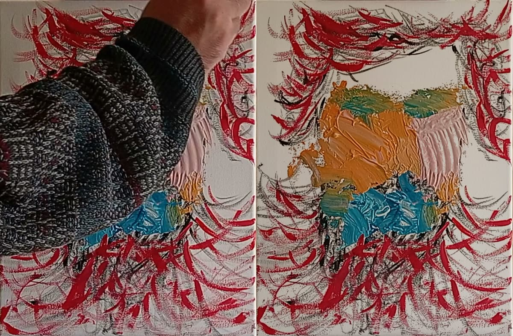
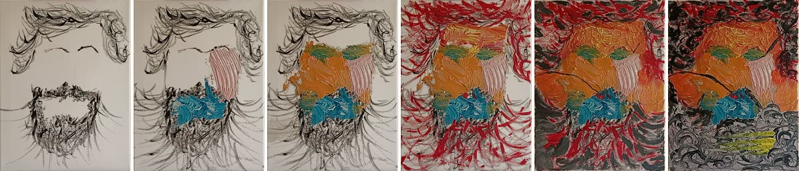
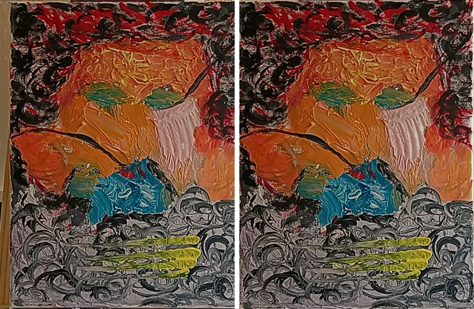

# Afterimage

**Film yourself painting. Afterimage takes the painter out of the footage, and the painting stays.**



*The camera 27 minutes into the third session (left), and Afterimage at the same second (right).*

Every pixel in the output is derived only from camera frames: aligned, colour-matched and
averaged over a few frames. No generative model touches the image. Nothing is invented.

Built for the Meta Global AI Developer Hackathon (Oct 26 – Nov 4, 2026), Indie track, theme
*Build for Your World*: I paint, and every process video I film is mostly my own elbow.
Built with **SAM 3.1** and **Muse Spark**, either through the Meta Model API or from the open
weights: SAM 3.1 on a Modal GPU and Muse Spark Open through Baseten. The first two sessions
here were processed both ways and the third through the API; each run's receipt names the path
that made it.

## What it does

- **A hands-free timelapse.** The painter, their hands and tools are removed and each stroke
  appears the moment the camera first saw it, dated to that moment.

  
- **Cameo.** You sit beside the canvas with a cup of tea while it fills in. The timelapse is
  projected into a real clip of the room (a labelled composite).
- **Pixel receipt.** Tap any spot on the finished painting and the camera footage of the last
  stroke there plays at natural speed, sound on, with the spot marked in the frame. The hand
  that painted it is right there.
- **Underneath.** Drag to peel the painting back one layer of strokes at a time, down to the
  bare canvas. Conservators find this under old paintings with X-rays and call it pentimento;
  here it falls out of the record.
- **Ghost slider.** Fade the painter back in from 0% to 100%.
- **A checkable record.** `receipt.json` holds the footage hash, the hashes of every cached
  model response, the parameters, and a hash chain over every output frame.
  `scripts/afterimage_verify.py` re-derives the whole output from the footage and the caches
  and compares. It passes on both sessions' final runs (84 minutes and 5,023 output frames;
  52 minutes and 3,120), every frame bit for bit, with no API key. Checkable, not proof: it
  shows the output came from this footage through this code, nothing more.

## How it uses Meta's models

| Model | Where | Job |
|---|---|---|
| **SAM 3.1** (`sam-3.1`) | [`afterimage/sam.py`](afterimage/sam.py) | Tracks every concept Spark asks for (`person`, `hand`, `paintbrush`, plus what Spark adds) through the whole session at 1–2 fps, one streaming call per concept, event streams cached and hashed. Follows the critic's boxes through the video as box prompts. |
| **Muse Spark 1.3** (`muse-spark-1.3`), scan | [`afterimage/spark.py`](afterimage/spark.py), [`afterimage/pipeline.py`](afterimage/pipeline.py) `spark_scan` | Watches a 48 s digest of the session and decides what else SAM should track (a rag, a cup, a cat), with a strict kind enum, and finds the canvas corners. Each extra concept is a SAM pass over the whole session, so Spark chooses which ones are worth it. |
| **Muse Spark 1.3**, critic | [`afterimage/critic.py`](afterimage/critic.py), `pipeline.critic_rounds` | After the clean plate has run, Spark sees (camera \| reconstruction) pairs at the moments most likely to have gone wrong and boxes anything that isn't paint. Objects go back to SAM as box prompts, shown at the frame the box's content arrived (the change timeline knows), when the brush or hand that left it was still in view; shadows, glare and smears are held, which drops the change that put them there. At most two rounds, and a round that changes nothing ends the loop; every decision cached and recorded, so verify replays it without asking. |
| **Open-weight mode** | [`scripts/sam_modal.py`](scripts/sam_modal.py), [`afterimage/sam_open.py`](afterimage/sam_open.py), `SPARK_PROVIDER=baseten` | The same pipeline with the weights instead of the API: `facebook/sam3.1` runs on a Modal GPU (text prompts for the concepts; the critic's boxes go to the SAM 2-style tracker SAM 3 ships, since SAM 3's own box prompt means "more things like this" rather than "this thing"; masks returned as a hashed file that names the tracker), and Muse Spark Open answers through Baseten's endpoint, with the schema enforced as a forced tool call and the digest sent as frames. The receipt names which path was used. |
| **Muse Image** | not used | Would contradict the promise. |

Every call goes through [`afterimage/ledger.py`](afterimage/ledger.py): model, endpoint, purpose,
prompt, response id, usage, time and estimated cost, appended to the run's `ledger.jsonl`.
Media is logged by SHA-256 only; the API key is scrubbed; the ledger's hash is in the receipt.

## How it works

```
footage ─┬─► proxy (1–2 fps) ─► Spark scan: what to track, where the canvas is
         │                        │
         │                        ▼
         │                      SAM 3.1: one mask stream per concept ──► painter masks
         │                                                                  │
         └─► canvas view (corners snapped, then followed; ffmpeg warp) ──────┤
                                                                            ▼
                      clean plate: a pixel changes only after its new value holds
                      for the persistence (8 s) while uncovered; every change is
                      recorded (pixel, first seen, before, after); a stroke's colour
                      settles over its first minute, later drift is marked as drift
                                                                            │
                      transient veto: a change undone within 1 min was a shadow,  ◄── Spark critic
                      a glint or a resting hand, not paint; both changes dropped        boxes → SAM /
                                                                            │           holds
                                                                            ▼
                      replay ──► timelapse · compare · reels · receipt page · receipt.json
```

The hard cases, and what handles them:

- **A resting hand.** Masked by SAM; the persistence rule and the veto cover a mask that
  slips, and the critic covers what both miss.
- **A painted hand, or a portrait.** SAM finds painted hands too. Real ones reach in past the
  canvas edge, move, and belong to a body; painted ones sit inside the canvas, stay put and
  outlast any pose ([`afterimage/occluders.py`](afterimage/occluders.py)). Only the real ones are removed.
- **Shadows, glare, exposure drift.** The phone's auto-exposure and white balance are measured
  on the room around the canvas: the median ratio over its lit pixels, with the painter masked
  out. Measured on the canvas itself, a pink wash laid over the whole canvas read as the light
  changing and was divided out. A canvas that fills the frame falls back to the bare canvas or
  paint that has stood for five minutes, never the drifting plate itself. A shadow that flickers
  never commits; one that holds still commits and is vetoed if it lifts within a minute. A
  shadow that holds still *and never lifts* is the known limitation (below).
- **A stroke that keeps changing.** Paint dries darker, and thin layers build up below the
  change threshold. For its first minute a stroke's recorded colour follows what the camera
  keeps showing; after that, drift past 4 levels (0-255) is recorded as a drift change, dated
  when it happened. The replay applies it, so the colour on screen keeps up with the camera;
  the receipt, Underneath and the stats ignore it, so a spot is still dated by the stroke that
  painted it.
- **Where the canvas is.** Spark's corners land within a few percent of the frame, which is an
  easel clamp across the top of every output. [`afterimage/corners.py`](afterimage/corners.py) moves
  each edge onto the innermost strong bright-to-dark step nearby with a robust line fit, on the
  clearest of the first frames, and keeps Spark's quad if no clean edge is found.
- **A knocked easel.** On the third session the palette knife pushed the easel twice: 13 px two
  minutes in and 25 more at half an hour (1080p), with a slow creep around both. Held at the
  first corners, the painting slid in the output and a strip of wall grew down its left edge.
  [`afterimage/track.py`](afterimage/track.py) matches the canvas every frame against a recent
  clear view of itself: a shift, turn and scale fitted on its edges (strokes and border) by
  Lucas-Kanade, with the painter masked out, the exposure taken out and new paint weighted
  down. When it has moved by more than half a pixel and holds there for five frames, the
  corners follow; ffmpeg straightens each frame with the corners in force, and the receipt
  records every move, so verify re-derives the same frames. A canvas with too little paint to
  place holds its corners, and then nothing on it can be misplaced either. On the third session
  the corners followed 32 times; the timelapse holds still across the second knock, where at
  fixed corners it slid 14 px (at 1280 wide) and stayed there, and the changes recorded as new
  paint fall from 14.3 million to 8.2 million. Nothing else differs between the two runs, so
  the other 6 million came from the slide: stroke edges read as repainted wherever they moved.

  
- **The first frame.** Each pixel starts from its first uncovered value that holds steady, so
  a painter in frame 0 doesn't linger, and a stroke made in the first seconds still arrives
  as new paint.

## Evaluation

### On two real sessions

Two sessions of acrylic on canvas, filmed by a phone on a tripod and processed at 1 frame a
second: session 1 is 84 minutes (5,023 frames), session 2 is 52 minutes (3,120 frames)
([`eval/session1-api-v3.md`](eval/session1-api-v3.md), [`eval/session2-api.md`](eval/session2-api.md)).
The step-back protocol, described below, finds the stretches where nobody was over the canvas
and it held still: 14 in session 1, 63 in session 2. Each was hidden from every method, rebuilt
from the rest of the session, and scored against what the camera saw.

| Session | Method | ΔE00, lower is better | Pixels clearly off (ΔE00 > 5) | PSNR (dB) |
|---|---|---|---|---|
| 1, 84 min | Afterimage | **2.92** | **16.0%** | **27.3** |
| | Masked median (Loomis-style, same SAM masks) | 4.01 | 18.4% | 25.7 |
| | Temporal median (no masks) | 5.59 | 27.2% | 21.4 |
| 2, 52 min | Afterimage | **2.24** | **6.1%** | **29.2** |
| | Masked median (Loomis-style, same SAM masks) | 2.54 | 8.4% | 29.2 |
| | Temporal median (no masks) | 3.92 | 15.4% | 25.1 |

Read honestly: Afterimage has the lowest average error on both sessions, but stretch by
stretch it beats the masked median about half the time (7 of 14, and 30 of 63). Its lead
comes from never breaking. When the painter steps back after a long spell at the canvas, the
median has nothing uncovered to work from: its worst stretches score 21.4 and 8.7, where
Afterimage scores 1.6 and 1.5. On calm stretches a 10-second median is nearly a copy of the
camera and edges ahead. Afterimage's own worst stretches come early in each session, where bare
canvas and a pale first wash sit under its change threshold: 5.5 against the median's 1.2 at
3:32 into session 2.

How it got here: session 1 scored 3.60 / 20.9% / 26.0 dB on Oct 31, and session 2 scored
3.05 / 10.8% / 27.5 dB on the morning of Nov 1. Since then, exposure is measured on the room
instead of the canvas, a change counts as transient only if it is undone within a minute, and
the record follows a stroke's slow drift past 4 levels instead of 12. The last change did most
of the work on session 2: the record had lagged what the camera showed on every stroke older
than a minute.

### On synthetic scenes

These were written alongside the method. They show it does what it was designed to do; they
are not a stand-in for footage.

Three scenes, three methods ([`eval/synthetic.md`](eval/synthetic.md), `scripts/afterimage_bench.py`):

| Scene | Afterimage | Masked median (Loomis-style) | Temporal median (no masks) |
|---|---|---|---|
| Moving hand + shadow: frames with a visible leftover | **0.0%** | 47.8% | 92.2% |
| Resting hand + still shadow: frames with a visible leftover | **0.0%** | 55.6% | 93.3% |
| Painted hand: frames with a visible leftover | **0.0%** | 27.8% | 83.3% |

The step-back protocol ([`afterimage/heldout.py`](afterimage/heldout.py), `scripts/afterimage_eval.py`)
hides the frames where nobody is over the canvas from every method, rebuilds, and scores
against what the camera saw there. A test shows hidden means unseen: a stroke first uncovered
inside a hidden window is missed (5.5% of pixels off) and caught when the method is allowed
to peek (0.3%). On the synthetic session: Afterimage ΔE00 0.27, 0.35% of pixels clearly off,
PSNR 39.6; masked median 0.74 / 1.14% / 28.4; temporal median 1.15 / 2.08% / 25.4.

### The critic, measured

`scripts/critic_probe.py` cuts hands and brushes out of a session's own footage with their SAM
masks, pastes one into each of 20 rebuilds at a random spot, leaves 20 more alone, and asks
Spark about them the way the runs do, two images a call
([`eval/critic-session1-api-v3.md`](eval/critic-session1-api-v3.md),
[`eval/critic-session2-api.md`](eval/critic-session2-api.md)). A plant counts as found when a
box overlaps it (IoU ≥ 0.3); any other box is a false flag.

| Session | Spark boxed | After the second look | False flags per image, before → after |
|---|---|---|---|
| 1 (blue on white) | 9 of 20 | 9 of 20 | 0.40 → 0.10 |
| 2 (pink, close to skin) | 6 of 20 | 4 of 20 | 0.70 → 0.12 |

Read plainly: the critic is a net under the masks, not a guarantee. SAM's masks do the
removing; Spark catches about half of what slips past them on a painting that doesn't look like
skin, and a third or less on one that does. The second look on a crop of the rebuild alone is
what makes acting on its answers safe: it removes most false flags while keeping the true finds
on session 1. Asked about six images in one call instead of two, it boxed 4 of session 2's
plants instead of 6. On both sessions' final runs the critic found nothing to fix. The loop's plumbing is covered by
tests with SAM and Spark played by mocks.

## Run it

```
python -m venv .venv && .venv\Scripts\pip install -r requirements.txt   # ffmpeg on PATH
copy .env.example .env                                                   # MODEL_API_KEY=...
python scripts/afterimage_run.py data/session.mp4 --corners 0.12,0.08 0.88,0.07 0.9,0.95 0.1,0.96
python scripts/afterimage_verify.py out/session/receipt.json --video data/session.mp4
python scripts/afterimage_eval.py data/session.mp4 --static 300-360
python scripts/cameo_run.py data/sitting.mp4 out/session/timelapse.mp4 --corners-from out/session --track sam --reveal
```

`--no-scan` skips the Spark scan; `--corners` given by hand always win and are never snapped;
`--start 3` skips the seconds while the phone was being set down; `--out <folder>` puts the
outputs and caches somewhere other than `out/<session>`. The results page is
`out/<session>/index.html`; it runs from disk. Next to it: `receipt.json`, `stats.json`,
`frames.json` (per frame: share covered, mask stillness, disagreement with the plate, exposure
gain) and the request ledger. `python scripts/afterimage_share.py out/<session> share/<session>`
copies the page into a folder any static host can serve, with the footage behind the receipt
re-encoded at the size the page shows it. The core is numpy plus ffmpeg pipes (no OpenCV), so it
runs on Windows N editions too. Tests: `python -m unittest discover -s tests -t .`

Open weights instead of the API (needs Hugging Face access to `facebook/sam3.1`, a Modal
account and a Baseten key):

```
modal setup
modal secret create huggingface HF_TOKEN=hf_...
modal deploy scripts/sam_modal.py
modal run scripts/sam_modal.py --video data/session.mp4 --concepts hand,person --seconds 30   # overlay check
python scripts/afterimage_run.py data/session.mp4 --masks open --corners ...              # SPARK_PROVIDER=baseten in .env
```

## Filming a session

What the two sessions here taught:

- **Phone on a tripod, canvas clamped, easel held.** On the first session the easel crept about
  2 cm sideways under the brush, and on the third the palette knife knocked it twice. The canvas
  is followed now, but a knock blurs a second or two and turns the paint's shine with it. Tighten
  the clamp on the canvas and tape the easel's feet to the floor.
- **Lock exposure and focus** on the canvas (long-press it on the phone screen).
- **Soft light, high, from the phone's side of the room.** A lamp bounced off the wall or ceiling
  behind the phone keeps your shadow behind your arm and off the paint. Before starting, lay one
  wet stroke and look at the phone screen: a shine on it will be in the output, so raise the
  light or tip the canvas's top edge forward until it goes.
- **A plain background.** A sheet pinned behind the easel hides posters and gives the exposure
  measurement a clean surround.
- **A quiet room.** The page plays each spot's moment with its sound: the brush is worth hearing.
- **For a cameo,** stop recording when you finish, then film yourself sitting beside the canvas
  without moving the phone, and pass `--corners-from` the run: the painting lands exactly on the
  canvas.

## Limitations

- A fixed camera is required; handheld footage isn't supported. The canvas may move on the easel
  and is followed, as long as it stays in view and has paint on it to be placed by.
- A shadow the painter casts that holds still past the persistence is recorded like paint. If
  it lifts within a minute, both changes are dropped. If it stays longer, or the paint under it
  changes before it lifts, it shows until that spot is next seen clear: on the second session,
  where a shadow on pink paint reads as brown, the arm's shadow shows as brown patches for a few
  seconds at a few moments of the 104-second timelapse. A longer veto window doesn't fix it:
  tried on the session's record, 120 seconds dropped half of all changes and nearly doubled the
  error where nobody covers the canvas. Muse Spark Open's critic boxed one patch (as a smear,
  which is only recorded); Spark 1.3 passed over it. Light from the phone's side of the room
  avoids most of it (see [Filming a session](#filming-a-session)).
- The camera's colour is not the pigment's colour. Steady light; a grey card helps. Lock the
  phone's exposure and white balance: the pipeline undoes auto-exposure drift, but what it can't
  see under the painter it can't correct.
- A lamp reflected off wet paint is in the footage, so it is in the output until the paint
  dries. Put the lamp high, where the phone screen shows no hot spot on a wet stroke.
- Thin brushes under motion blur can slip past the masks; persistence and the critic are the net.
- A wash close to the canvas colour (a pale pink ground over white) sits under the change
  threshold and registers late, or only where it is strongest, until stronger paint arrives.
- In open-weight mode the critic's box is followed within its 10-minute stretch of the session
  (the tracker works in chunks); a leftover that outlasts the stretch is caught again by the
  next round, not carried over.
- Works for flat work under a fixed camera: paper, canvas, boards.

## Prior work

Removing the painter statistically goes back to Clady (SIGGRAPH 2006 poster) and Tan et al.
(SIGGRAPH 2015), who handled the hand and its shadow with keyframed temporal statistics for
stroke-layer decomposition. Loomis Painter (2025) uses a masked median per 10-second segment
to build a training set and reports that it cannot handle hand shadows. Whiteboard cameras
(MSR 2004, Kaptivo, Microsoft Teams, Logitech Scribe) remove the presenter from a whiteboard
with real pixels. Repentir (Manchester Metropolitan University) recognises a finished painting
in a photo and overlays photos taken while it was being made, which is the pixel receipt's
question asked the other way round. Generative erasers (Runway, Kling, Veo) regenerate the
scene and invent strokes. No shipped tool does this for physical painting video. What's new here is the
combination: open-vocabulary SAM 3.1 masks chosen by Spark, a clean plate that dates every
pixel and can revoke changes, a critic loop that re-prompts SAM, a held-out evaluation against
the standard baselines, and a receipt you can re-derive.

## Built during the hackathon

All code was written from Oct 26, 2026. The first nine commits were made together on
Oct 27 from a day of local work; everything after is committed as it was built, and the
repository went public on Oct 30 with that local history intact. Solo entry by Mishal
(Mishallic). Model responses are cached under `out/` and are not committed.

Built with Muse Spark Open.
